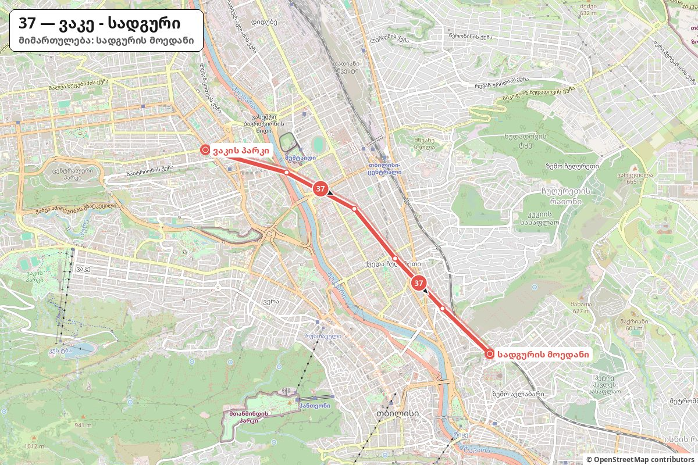
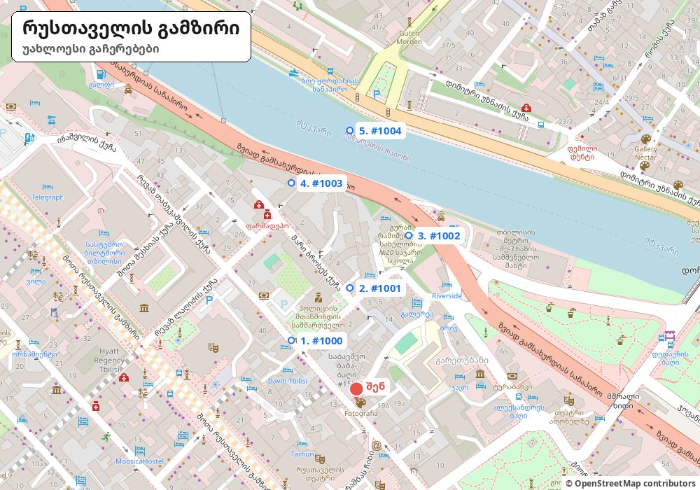

<div align="center">

# 🚌 DiscordTTCBOT

**Live Tbilisi public transport in Discord.**
Real-time arrivals, route maps with moving buses, nearby stops and arrival alerts,
powered by the same API as the official Tbilisi Transport app.


</div>

---

## ✨ Features

- **📡 Live arrivals:** `/stop` shows every bus, metro and ropeway arriving at a stop, with realtime vs. scheduled times, a 🔄 refresh button and a 🗺️ map.
- **🗺️ Route maps with live vehicles:** `/bus 37` renders an image of the route, its stops and every vehicle currently on the line, with an arrow showing which way each one is heading. You can switch direction with one click.
- **📍 Nearby stops:** `/nearby Rustaveli` (or `41.70, 44.79`) finds the closest stops and the walking distance to each.
- **🔔 Arrival alerts:** `/watch` sends you a DM when your bus is N minutes away.
- **🔎 Search everything:** autocomplete on every stop and route, plus `/stops` and `/routes`.
- **🔑 Survives key rotation:** the bot finds the current TTC API key by itself, so it won't silently die again (see [below](#-how-it-works)).
- **🤖 AI extras:** `/ask` and `/analyze` through OpenRouter.

<div align="center">

| `/bus` | `/nearby` |
|:---:|:---:|
|  |  |

<sub>Example renders. Map data © OpenStreetMap contributors.</sub>

</div>

## 💬 Commands

| Command | Description |
|---|---|
| `/stop <stop> [route]` | Live arrivals at a stop, optionally filtered to one route |
| `/bus <route>` | Route map with live vehicles · ⇄ direction · 🔄 refresh · 📋 stop list |
| `/routes [mode]` | All bus 🚌 / metro 🚇 / ropeway 🚡 routes |
| `/stops <query>` | Search stops by name or code |
| `/nearby <place>` | Closest stops to an address or `lat, lon` |
| `/watch <stop> <route> [minutes]` | DM alert when the vehicle is close (1 h, max 3 per user) |
| `/unwatch` | Cancel your alerts |
| `/apistatus` | TTC API health and current key source |
| `/ask` · `/stats` · `/analyze` | AI and passenger statistics |
| `/help` · `/ping` · `/uptime` | Utilities |

## 🚀 Quick start

```sh
git clone https://github.com/xenycx/DiscordTTCBOT.git
cd DiscordTTCBOT
python3 -m venv venv && source venv/bin/activate
pip install -r requirements.txt
cp ".env example" .env      # then put your DISCORD_TOKEN in .env
python bot.py
```

### Environment variables

| Variable | Required | Purpose |
|---|:---:|---|
| `DISCORD_TOKEN` | ✅ | Your bot token |
| `API_KEY` | | TTC key override. Leave empty; it is discovered automatically |
| `OPENROUTER_API_KEY` | | Enables the AI commands |
| `DISCORD_WEBHOOK_URL` | | Log channel (also announces TTC key rotations) |
| `TILE_URL` / `TILE_SIZE` / `TILE_ATTRIBUTION` | | Use a different raster map provider |
| `TILE_CACHE_DIR` | | Where map tiles are cached (default `cache/tiles`) |

> Map labels need a Georgian-capable font (Noto Sans Georgian or DejaVu Sans). The Docker image installs them.

## 🐳 Docker

```sh
docker build -t ghcr.io/xenyc1337/discordttcbot:latest .
docker compose up -d
```

`docker-compose.yml` reads the variables above from your shell or `.env` and keeps
the tile cache in a named volume.

## 🔍 How it works

The API was reverse engineered from the official **Tbilisi Transport** Android app
(`com.azry.wandio.ttc.android` 3.1.3, React Native/Hermes) and the
[transit.ttc.com.ge](https://transit.ttc.com.ge) web client.

```
https://transit.ttc.com.ge/pis-gateway/api    header: X-api-key
├── v2/stops                         all stops
├── v2/stops/{id}/arrival-times      live arrivals
├── v3/routes?modes=BUS,SUBWAY,GONDOLA
├── v3/routes/{id}                   route + direction patterns
├── v3/routes/{id}/stops             stops of a pattern
├── v3/routes/{id}/polylines         encoded route geometry
├── v3/routes/{id}/positions         live vehicles (lat, lon, heading, nextStopId)
└── v2/geocode                       address search
```

**Why the bot died, and why it won't again.** The bot used to hardcode a TTC API key.
TTC rotates that key: the official apps fetch `PIS_GATEWAY_KEY` from Firebase Remote
Config and refresh it whenever the API answers `401`. The bot's key went stale and
every command broke.

`ttc/client.py` now resolves the key the same way the apps do:

1. `API_KEY` from `.env` (optional override)
2. the key published in transit.ttc.com.ge's page config
3. the live Firebase Remote Config value
4. the last known default shipped in the app

On a `401` the rejected key is blacklisted, a fresh key is resolved **once** (behind
a lock, so 20 simultaneous failures cause a single refresh), and the request is
retried. Responses are cached briefly to stay gentle on TTC's servers.

Map images are drawn locally with Pillow on OpenStreetMap tiles, which are cached on
disk. The bot uses no paid map API.

## 📁 Project layout

```
bot.py              entry point
config.py           env + logging config
ttc/client.py       TTC API client (key discovery, caching, retries)
ttc/maprender.py    static map renderer
ttc/polyline.py     encoded polyline decoder
cogs/transit.py     transit commands
cogs/ai.py, stats.py, help.py, uptime.py
```

## 🤝 Contributing

Issues and pull requests are welcome. Fork, create a feature branch and open a PR.

<sub>Not affiliated with Tbilisi Transport Company. Transit data © TTC · Map data © OpenStreetMap contributors.</sub>
